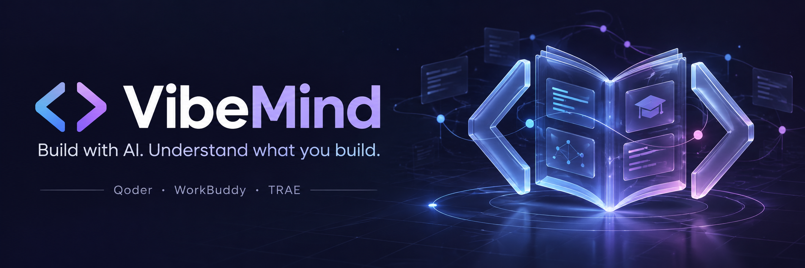

<div align="center">



# VibeMind

**面向 Vibe Coding 的自适应编程引导工具链**

[](https://skills.sh/tfboy1/vibemind/vibemind)
[](https://www.ifdian.net/item/1a20ed042f0711f1865a52540025c377)
[](https://www.creem.io/payment/prod_1yc40mIhKwwrc7iqFOG9G2)
[](https://github.com/TFboy1/VibeMind/stargazers)
[](LICENSE)

<br/>

[](#运行要求)
[](https://modelcontextprotocol.io/)
[](https://www.sqlite.org/)

<br/>

[](#)
[](docs/README_EN.md)
[](docs/README_JA.md)
[](docs/README_FR.md)
[](docs/README_DE.md)

</div>

VibeMind 把编程引导放进真实的 AI 开发流程。它由 Skill、本地 stdio MCP 和 CLI 组成：Skill 结合当前任务、项目代码和用户在不同主题上的熟悉程度调整引导深度；MCP 与 CLI 共用本机 SQLite 记忆，让项目上下文、设计决定和概念讲解历史能跨项目与会话接续，也能供指向同一数据库的多个本机宿主共享。

## 主要能力

- **按主题调整引导**：从真实代码和任务约束出发，讨论实现取舍；陌生概念直接解释，熟悉内容聚焦当前应用和新差异。
- **默认不重复已覆盖内容**：每次解释前查询精确概念 ID 或明确别名，对照既往 `scope` 只跳过已覆盖范围，未讲过的基础内容仍会解释；缺少用户应用证据不会触发重讲。相似候选、父概念和未讲过的子概念不会混为一谈。
- **设计过程可接续**：保存项目地图、知识卡和全部未完成决定；跨项目共享通用偏好及概念讲解历史。
- **讲解与应用分别记录**：AI 实际讲解后保存 `explained` 证据；用户实际应用另记为 `applied`。没有应用记录不代表需要重新讲解。
- **本机存储**：无需额外账户、云服务或模型 API。MCP 只通过标准输入输出通信。

> [!NOTE]
> 安装 Skill 或连接 MCP 不会自动初始化项目，也不会自动启用引导。请在目标项目中明确调用 VibeMind；没有自动 Hook 的宿主在新会话中也需要重新调用。

## 开始使用

### 安装 Skill

需要 Node.js **22.20.0 或更新版本**，以及支持 Agent Skills 的 AI 开发工具。

```sh
# 在当前项目中安装
npx skills add TFboy1/VibeMind --skill vibemind --copy

# 或安装到 Codex 用户级技能目录
npx skills add TFboy1/VibeMind --skill vibemind --agent codex --global --copy
```

保留完整的 `skills/vibemind/` 内容，包括 `SKILL.md`、`NOTICE.md`、`references/` 和 `scripts/`。只复制 `SKILL.md` 会缺少引导规范与 CLI。

在项目中明确调用，例如：

> 使用 VibeMind 作为这个项目的编程引导工具。我想给 Vue＋FastAPI 项目增加库存预留，请先查看已有代码和约束，再结合我的思路讨论方案。

用户可以随时要求解释概念、只讨论方案、跳过讲解或按已确认范围直接实现。设计确认不会自动授权尚未讨论的代码改动。

### 配置本地 MCP（可选）

将完整仓库放在固定目录，并在仓库运行一次：

```sh
npm ci
```

在支持 stdio MCP 的宿主中添加配置，将示例路径替换为仓库的绝对路径：

```json
{
  "mcpServers": {
    "vibemind": {
      "command": "node",
      "args": ["D:/tools/VibeMind/scripts/mcp.mjs"]
    }
  }
}
```

宿主会启动并管理 MCP 进程；无需 HTTP 服务或端口。CLI 只依赖 Node.js 内置模块，MCP 使用仓库中的官方 SDK。

MCP 提供 20 个工具，覆盖初始化、上下文、记录、暂停/恢复、知识查询、精确读取、分页、提交回执、诊断、配置、迁移、纠错、删除、遗留锁处理和在线备份。完整参数见[记录规范](skills/vibemind/references/records.md)。

### Claude Code、Codex、WorkBuddy 共享记忆

Skill 可保留各宿主自己的安装目录，学习库独立保存在 `~/.vibemind/memory.sqlite`。无需先安装全部宿主；后来安装的软件先用 `doctor/status` 核对实际库路径、`storeId`、软件/API/数据库版本和项目 ID，即可读取原学习记录与暂停状态。

用户选择自定义目录时运行一次：

```sh
node "<技能目录>/scripts/vibemind.mjs" configure --memory-home "<本机共享记忆绝对目录>"
node "<技能目录>/scripts/vibemind.mjs" doctor --cwd "<项目绝对目录>"
```

配置保存在 `~/.vibemind/config.json`，以后安装的宿主读取同一配置；`VIBEMIND_HOME` 环境变量仍优先，`VIBEMIND_CONFIG` 可指定另一绝对配置文件。配置不会复制/合并已有库，已有身份连接错库或记录缺失时拒绝空建。旧 MCP 进程需重启并核对返回的真实连接信息。

支持同一学习者、同一系统环境、可靠本机文件系统的多个宿主。Windows/WSL 的不同写入器不能直接写同一文件；NAS/SMB、实时同步活库、跨机器/离线库合并不在本版本范围内。

## 记忆如何保存

- 用户档案和跨项目概念图谱保存在用户目录的 SQLite 数据库中。
- 项目目录保存 `.vibemind/project.json` 身份文件，绑定项目 ID 和库 ID；初始化中断有待完成标记，可由 `init` 安全接续。项目地图、观察、知识卡和决定保存在数据库。
- 移动项目目录后可按项目 ID 接续。复制目录若与仍存在的原项目共享 ID，会报告冲突；明确要建立独立项目时使用 `init --new-project`。
- 首次 `init` 校验并导入旧 JSON，保留旧文件、暂停状态和未完成决定。格式 1 的 SQLite 先用 `migrate` 在线备份升级，再初始化绑定。读取本身不迁移、初始化或恢复项目。
- 项目和用户档案使用独立版本号；所有业务写入（含暂停/恢复）必须携带预期库/项目 ID、版本和唯一操作编号。并发冲突先读取完整内容并整合；丢响应可查回执，重试不重复提交或翻转当前模式。
- 默认 `summary` 共享通用讲解范围/摘要，隐藏其他项目卡片正文和代码位置；敏感项目可选 `private`，用户明确允许共享完整案例时选 `full`。摘要文字仍需避免私密内容，这不是多用户权限系统。
- 用户指出误记时可撤销证据/更正别名，旧内容保留修订；别名更正另核对全局图谱版本。`correct` 支持明确更正已删除目录或暂停项目的旧来源；`purge` 用项目 ID 确认删除活动记录及修订，不删除备份、旧 JSON 或宿主聊天。
- 通用档案更新也必须标明来源项目；来源暂停时拒绝更新，其他活跃项目继续使用共享档案。
- 保存简短摘要：新字符串最多 128 KiB，单批输入和项目状态 JSON 最多 512 KiB，MCP 业务响应最多 2 MiB。CLI stdin 提前限额，MCP 传输缓冲 1 MiB；超限不部分提交。精简写入回执不截断 `context` 的未完成决定，旧记录可用 CLI/get 读取；证据超过 100 条用 `history` 分页。

## CLI

CLI 随 Skill 分发。将 `<技能目录>` 替换为实际安装位置，将 `<项目目录>` 替换为项目绝对路径：

```sh
node "<技能目录>/scripts/vibemind.mjs" status --cwd "<项目目录>"
node "<技能目录>/scripts/vibemind.mjs" context --cwd "<项目目录>"
node "<技能目录>/scripts/vibemind.mjs" context --cwd "<项目目录>" --topic "CORS"
node "<技能目录>/scripts/vibemind.mjs" knowledge --topic "跨域" --limit 20 --depth 2
node "<技能目录>/scripts/vibemind.mjs" get --cwd "<项目目录>" --kind card --id "<知识卡ID>"
node "<技能目录>/scripts/vibemind.mjs" history --concept-id "cors" --limit 100
node "<技能目录>/scripts/vibemind.mjs" operation --operation-id "<提交时的UUID>"
node "<技能目录>/scripts/vibemind.mjs" backup --output "<绝对路径>/memory-backup.sqlite"
```

用户明确启用 VibeMind 时才运行 `init`。主题查询会返回解释状态、相关知识卡、证据及其来源。关联深度最多两跳，备份使用 SQLite 在线备份接口，且不会覆盖已有文件。

CLI 输出支持 JSON；`context` 默认输出 Markdown。完整参数、MCP 工具和记录格式见[记录规范](skills/vibemind/references/records.md)，引导行为见[教学规范](skills/vibemind/references/teaching.md)。

### 从 0.2/0.3 升级到 0.4.0

1. 更新各宿主完整 Skill、CLI 和 MCP，重启 MCP 进程，用 `doctor` 确认实际记忆库路径。
2. 对格式 1 库运行 `node "<技能目录>/scripts/vibemind.mjs" migrate`。程序持写锁，先保存并验证旧库在线备份，再升级为格式 2；失败回滚，随后旧写入器拒写。
3. 对已有项目运行 `init --cwd "<项目目录>"`，接续绑定同一项目，保留 revision、暂停和学习历史。不要用 `--new-project` 代替升级。
4. 所有业务写入携带 `expectedStoreId`、`expectedProjectId`、`expectedRevision`、`operationId`；`record-user` 的版本取 `userRevision`。新请求生成 UUID，同请求重试保留原输入/编号。

格式 1 库可只读，写入必须明确迁移。备份恢复需要停止所有写入者、保留现库并离线核验；恢复后用 `migrate --rotate-store-id --expected-store-id "<当前库ID>"` 轮换身份，再用 `init --rebind-store-id "<新库ID>"` 接续，拒绝恢复前的旧请求。没有自动覆盖活动数据库的 restore。

## 运行要求与验证

- Node.js 22.20.0 或更新版本（内置 SQLite）。
- 配置 MCP 需在仓库安装依赖；独立 CLI 不需要第三方运行依赖。
- 运行项目检查：

```sh
npm ci
npm run check
npm test
```

测试覆盖后来安装宿主、库绑定、旧写入器拒绝、初始化断点恢复、同项目/通用档案并发、回执重试、暂停、私有/摘要共享、超过 100 条历史分页、纠错/删除和备份恢复代际，以及真实 stdio MCP 的发现、并发、关闭和重启。当前修复与 72 项边界的范围见[边界审查](docs/MEMORY_BOUNDARIES.md)；真实三个产品的模型行为仍需分别接入验收。

设计参考及许可信息见 [NOTICE.md](skills/vibemind/NOTICE.md)。
